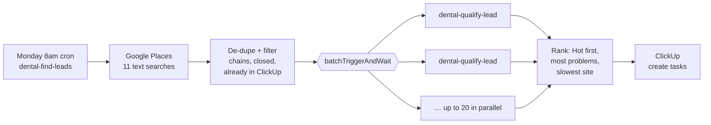

# Local Business Lead Finder — Dental Practices (Tampa, FL)

A scheduled TypeScript automation that finds local dental practices that need a new website, explains *why* each one is a good prospect, and drops them into ClickUp as ready-to-work sales tasks — every Monday morning, with no manual effort.

Built on [Trigger.dev](https://trigger.dev) (background jobs), the Google Places API, Google PageSpeed Insights, and the ClickUp API.

> **Built with AI assistance.** I designed and built this project with [Claude Code](https://claude.com/claude-code) as a pair programmer, using the workflow defined in [`CLAUDE.md`](CLAUDE.md) (understand → research → clarify → plan → build → test → verify). I made the product decisions, set up all the service accounts, ran and reviewed every test, and directed the debugging. Both instruction files are included so the process is transparent.

---

## What it does

Every Monday at 8:00 AM Eastern:

1. **Finds practices.** Runs 11 Google Places searches across Tampa neighborhoods and specialties (up to 60 results each) and de-duplicates by Google Place ID.
2. **Filters out non-prospects.** Drops corporate chains (Aspen Dental, Coast Dental, …), closed businesses, and anything already in the ClickUp list from a previous week.
3. **Audits each website** in parallel (20 at a time) and rates it:
   - 🔥 **Hot**: no website, only a Facebook/Linktree-style page, a broken site (404/500, dead domain), or an invalid SSL certificate
   - 🟡 **Warm**: a real site with 2+ problems: no HTTPS, not mobile-friendly, a copyright year 3+ years old, or a PageSpeed mobile score below 50
   - ✅ **Good**: skipped, since there's nothing to pitch
4. **Creates ClickUp tasks** for the top 30 leads (Hot first) with phone, address, Google rating, Maps link, and the specific problems found, which double as talking points for the sales call.

### Example result (test run, Nov 17 2026)

| Metric | Value |
|---|---|
| Practices found | 334 |
| Websites audited (after removing chains) | 297 (0 failures) |
| 🔥 Hot leads | 21 |
| 🟡 Warm leads | 1 |
| Good sites skipped | 275 |
| ClickUp tasks created | 22 |

Example task:

```
Terrace Smiles Dentistry — 🟡 Warm                     Priority: Normal

WHY PITCH THEM
• Outdated (© 2021)
• Slow on mobile (PageSpeed 5/100)

CONTACT
Phone: (813) …   Address: …   Google rating: 4.8 (… reviews)
```

---

## How it works



Two tasks, using an **orchestrator + processor** pattern:

| File | Role |
|---|---|
| [`find-leads.ts`](src/trigger/dental-leads/find-leads.ts) | Scheduled orchestrator: searches Places, filters, fans out website checks, ranks results, creates ClickUp tasks |
| [`qualify-lead.ts`](src/trigger/dental-leads/qualify-lead.ts) | Processor: audits one practice's website (HTTP fetch + HTML checks + PageSpeed) and returns a rating |
| [`config.ts`](src/trigger/dental-leads/config.ts) | All tunable settings: search queries, chain list, rating thresholds, weekly cap |

### Design decisions

- **Child task per website.** PageSpeed audits take 10–60 seconds each, so they run as separate Trigger.dev runs with a queue concurrency limit. The orchestrator's wait is checkpointed, so it uses no compute while waiting, and one slow or failing site can't take down the whole run.
- **ClickUp is the source of truth for de-duplication.** Each task stores its Google Place ID, and the next run reads the list (including closed and archived tasks) and skips anything already there. No database needed, and deleting a task lets that practice be re-evaluated.
- **Rank before you write.** All websites are rated first, then sorted, then capped at 30, so each week's tasks are the best available leads rather than the first ones found.
- **"Couldn't check" is not "broken."** Bot protection (403/429), unusual server behavior, or a failed PageSpeed call never turn a practice into a lead. Only clear failures (dead domain, refused connection, 4xx/5xx, bad certificate) count as Hot. False positives waste sales time.
- **Stays inside free tiers.** About 33 Places requests a week, roughly 140 a month, against 1,000 free Enterprise-tier requests per month. PageSpeed Insights is free.

### Bugs found during testing

Real-world data surfaced problems that unit tests wouldn't have caught:

1. **False "website won't load" leads.** Several popular practices (one with 1,000+ reviews) were flagged Hot. Root cause: their servers send very large HTTP headers (cookies or security policies), which exceed Node's built-in `fetch` limit (`UND_ERR_HEADERS_OVERFLOW`). Fix: website checks use `undici` with a 256 KB header limit, and fetch errors are classified by error code, so only DNS, connection, and certificate failures count as broken.
2. **ClickUp `ITEM_246: Max usage for custom task types reached`.** The target list defaulted to a custom "Lead" task type, which the ClickUp plan caps. Fix: always create standard tasks (`custom_item_id: 0`).
3. **Child runs expiring in the queue.** With about 300 checks queued, the last few waited longer than the dev environment's default 10-minute time-to-live. Fix: an explicit `ttl: "1h"` on each child run, plus higher concurrency.

### Known limitations

- "No website listed on Google" means the Google Business Profile has no link. Some individual-dentist listings belong to a group practice that does have a site, so verify before calling.
- Copyright-year detection reads the raw HTML, so sites that insert the year with JavaScript aren't detected (treated as no signal, not a problem).
- The Warm rule (2+ problems) is deliberately strict; adjust `WARM_MIN_ISSUES` in `config.ts`.

---

## Tech stack

- **TypeScript** on **Trigger.dev v4** (`schedules.task`, `task`, `batchTriggerAndWait`, queues, TTL, retries)
- **Google Places API (New)**: Text Search with a field mask
- **Google PageSpeed Insights API**: Lighthouse mobile performance score
- **ClickUp API v2**: list reads and task creation
- **undici**: HTTP client with a configurable header-size limit

---

## Run it yourself

**You'll need:** Node 20+, a [Trigger.dev](https://cloud.trigger.dev) account (free), a Google Cloud project with billing enabled (usage stays within the free allowance), and a ClickUp account.

```bash
git clone <this repo>
cd <repo>
npm install
cp .env.example .env      # then fill in the values (comments in the file explain each one)
```

| Variable | Where to get it |
|---|---|
| `TRIGGER_SECRET_KEY` | Trigger.dev dashboard → API Keys → dev key (`tr_dev_…`) |
| `GOOGLE_PLACES_API_KEY` | Google Cloud → enable **Places API (New)** + **PageSpeed Insights API** → Credentials → API key |
| `CLICKUP_API_TOKEN` | ClickUp → Settings → Apps → API Token (`pk_…`) |
| `CLICKUP_LIST_ID` | The number after `/li/` in your ClickUp list's URL |

Set your own project ref in [`trigger.config.ts`](trigger.config.ts), then:

```bash
npx trigger.dev@latest dev
```

Open the Trigger.dev dashboard → **Test** → `dental-find-leads` → **Run test**. To change the city or industry, edit [`config.ts`](src/trigger/dental-leads/config.ts).

---

## Roadmap

- [ ] Turn it into a multi-industry template (e.g. HVAC, roofing): shared core plus a small config file per niche
- [ ] Unit tests for the website-rating rules
- [ ] Email enrichment for Hot leads
